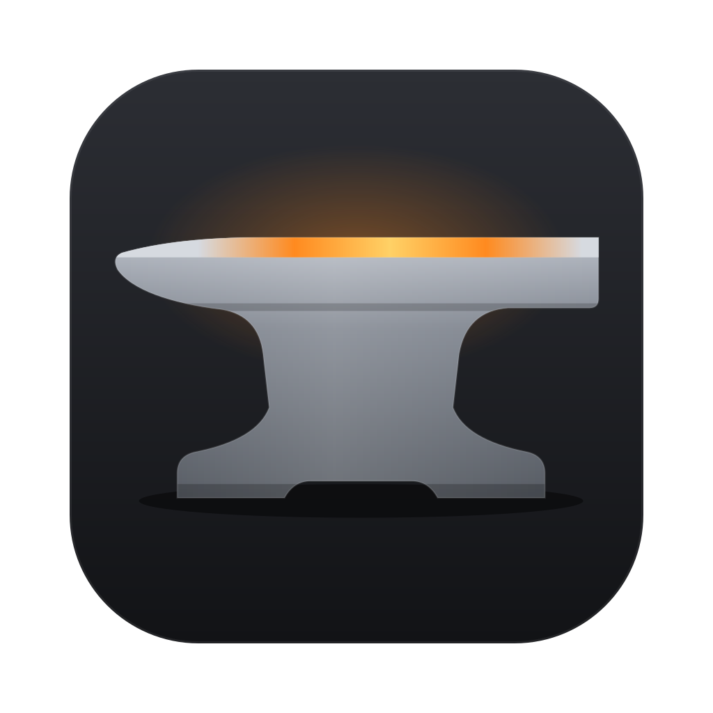

<div align="center">



# Anvil

**Your tools. Your rules.**

A fast, native local development environment for macOS.<br>
Free and open source. Built for developers.

</div>

---

Anvil turns the folders on your Mac into running applications at local domains like `myapp.test`, with HTTPS, isolated language runtimes, databases and per-application settings. No containers, no virtual machines and no changes to your system packages. Everything Anvil installs lives in `~/.anvil`, and so do the caches of the tools it runs; the only system changes are the ones you approve (a resolver file for the local domain, a trusted HTTPS certificate, an optional login item), and `anvil uninstall` removes them. The few exceptions, like Go's local telemetry counters, are listed in [Applications](https://anvil.tr/docs/applications#languages).

> **Status: early development.** The core works on macOS today. Expect breaking changes until 1.0.

## Why Anvil

- **Native and fast.** Runtimes and services run directly on your Mac. No VM layer between your code and the CPU.
- **Isolated.** PHP, Node.js, Go, Rust, .NET, Python and the services live in their own folders under `~/.anvil`. Nothing leaks into your shell or your system.
- **Per-application control.** Every application can have its own PHP version, php.ini settings, start command and port.
- **Everything included.** No paid tiers, no upsells. Every feature is free.
- **Open.** Apache 2.0 licensed. Read it, change it, ship it.

## Features

| | Status |
|---|---|
| Local domains (`*.test`) via a built-in DNS server | ✅ Available |
| Local HTTPS with a trusted certificate authority | ✅ Available |
| Park a folder: every sub-folder becomes an application | ✅ Available |
| Link any folder, add extra domains to an application | ✅ Available |
| Automatic detection: Laravel, Statamic, Symfony, PHP, static, Next.js, Nuxt, Vite, Node.js, Rust, Go, .NET, Django, FastAPI, Flask | ✅ Available |
| PHP 8.0 – 8.5, isolated, per-application version | ✅ Available |
| php.ini settings per application (own PHP-FPM pool) and global defaults | ✅ Available |
| Node.js, Go, Rust, .NET and Python (Django, FastAPI, Flask) toolchains, isolated in `~/.anvil` | ✅ Available |
| Apps with their own dev server, proxied to their `.test` domain | ✅ Available |
| Services: MySQL, PostgreSQL, Redis, Mailpit, any number of each | ✅ Available |
| New applications from templates | ✅ Available |
| Disk usage per application, with safe clean-up | ✅ Available |
| Logs, dependencies and Git status per application | ✅ Available |
| Native macOS app with menu bar | ✅ Available |
| Standard ports 80/443 via a privileged helper, URLs without `:8443` | 🛠 Next |
| Signed and notarized releases | 📋 Planned |
| Linux | 📋 Planned |
| Windows | 📋 Planned |

## Screenshots

<!-- Add screenshots of the Applications window, an application panel and Services here. -->
_Coming soon._

## Install

Anvil runs on macOS on Apple Silicon (Intel builds are untested). Build it from source with [Rust](https://rustup.rs):

```sh
git clone <repository-url> anvil && cd anvil
cargo install --path .
```

To build the native app as well, see [Getting started](https://anvil.tr/docs/getting-started#the-macos-app-optional).
What Anvil needs on your Mac (macOS version, tools, disk, network, ports) is in [System requirements](https://anvil.tr/docs/requirements).

## Quick start

```sh
anvil php install 8.4      # an isolated PHP; the first one becomes the default
anvil setup                # downloads the web server, prints the one-time DNS command
sudo mkdir -p /etc/resolver && printf 'nameserver 127.0.0.1\nport 5354\n' | sudo tee /etc/resolver/test
# or skip the line above: `anvil tld localhost` uses <folder>.localhost, no password needed
anvil park ~/Sites         # every folder in ~/Sites becomes <folder>.test (or .localhost)
anvil start                # the first start creates the local certificate authority
anvil trust                # in another terminal: trust it for HTTPS
```

Open `https://<folder>.test:8443` in your browser. [Getting started](https://anvil.tr/docs/getting-started) explains each step.

## Commands at a glance

| | |
|---|---|
| Sites | `anvil park`, `link`, `sites`, `new` |
| PHP | `anvil php install`, `use`, `ini` |
| Languages and apps | `anvil runtime install`, `app command`, `app port` |
| Services | `anvil service add`, `service list`, `service databases` |
| Inspect | `anvil usage`, `clean`, `logs`, `git`, `packages` |
| Run | `anvil setup`, `start`, `trust` |

Every command is in the [CLI reference](https://anvil.tr/docs/cli); `anvil --help` lists them too.

## Documentation

- [Getting started](https://anvil.tr/docs/getting-started): install, first run, HTTPS, DNS, uninstall
- [Applications](https://anvil.tr/docs/applications): detection, PHP, languages, templates, storage
- [Services](https://anvil.tr/docs/services): MySQL, PostgreSQL, Redis and Mailpit
- [The macOS app](https://anvil.tr/docs/app) and its keyboard shortcuts
- [CLI reference](https://anvil.tr/docs/cli)
- [Configuration](https://anvil.tr/docs/configuration): `config.toml` and the `~/.anvil` folder
- [Architecture](https://anvil.tr/docs/architecture): how the pieces fit together
- [Code signing](SIGNING.md): how releases get signed on macOS, Linux and Windows
- [Changelog](CHANGELOG.md)

## Contributing

See [CONTRIBUTING.md](CONTRIBUTING.md). To report a security issue, see [SECURITY.md](SECURITY.md).

## Built with

- [Rust](https://www.rust-lang.org)
- [Tauri](https://tauri.app) for the macOS app
- [Caddy](https://caddyserver.com) for serving and local HTTPS
- [static-php-cli](https://github.com/crazywhalecc/static-php-cli) for portable PHP builds

## License

Licensed under the [Apache License 2.0](LICENSE).
